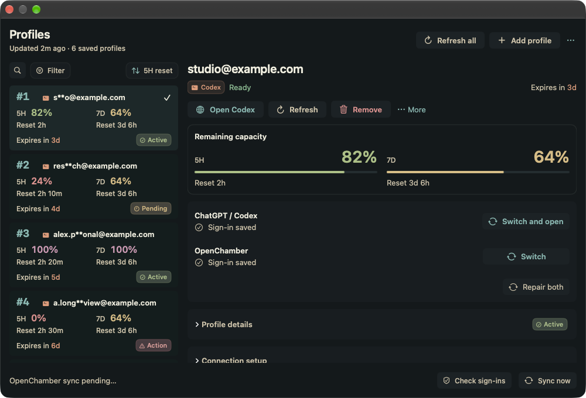
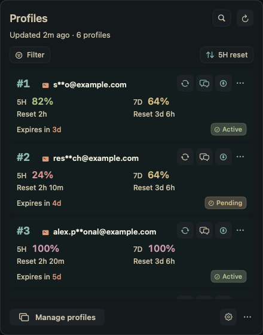
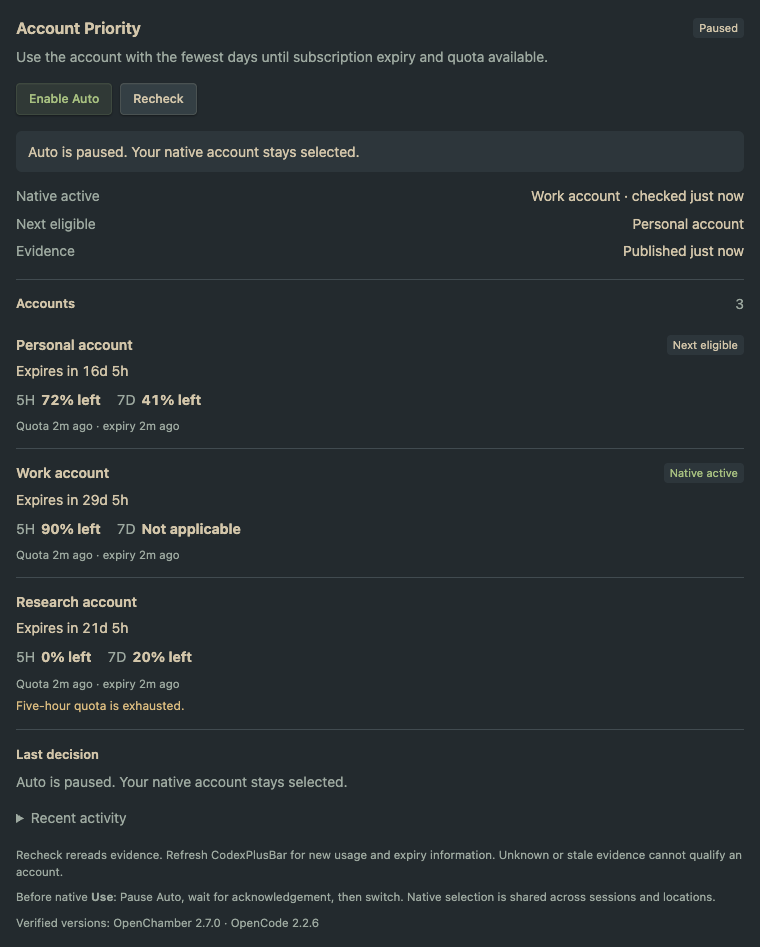

# CodexPlusBar

**Switch Codex accounts without signing in every time.**

CodexPlusBar is a **Mac account switcher for ChatGPT / Codex and OpenChamber**. Save your sign-ins, compare remaining quota, and switch to the account you need. Each browser account gets its own Chrome profile.

Hit a limit or need your work account? Switch to a saved sign-in instead of repeating the login flow.

**[Download Mac app (.dmg)](https://github.com/withLinda/CodexPlusBar/releases/latest/download/CodexPlusBar.dmg)** · **[Download OpenChamber extension (.zip)](https://github.com/withLinda/CodexPlusBar/releases/latest/download/expiry-selector.zip)** · [Quick start](#get-started) · [Release notes & checksums](https://github.com/withLinda/CodexPlusBar/releases/latest)

macOS 14+ · Apple silicon & Intel · Signed and notarized · [Google Chrome](https://www.google.com/chrome/) required for browser sign-in

*Choose an account, check its quota, and switch. Screenshots use sample accounts in 1.6.1; Account Priority uses extension 0.1.0.*

## Switch between your saved accounts

- **ChatGPT / Codex desktop:** choose **Switch and open** to verify the saved sign-in, change accounts, and reopen the app.
- **OpenChamber:** choose **Switch** to select the saved OpenAI account in your running local OpenChamber app.
- **Codex in Chrome:** choose **Open Codex** to open that account's dedicated browser profile.

### Set up app switching

1. [Add a profile](#get-started), then sign in to that account in ChatGPT / Codex or OpenChamber.
2. Choose **Save current sign-in** in that app's CodexPlusBar row. Repeat for each account and app.
3. Select a saved account, choose **Switch and open** or **Switch**, and wait for confirmation.

Finish active work before desktop switching: it closes and reopens the app. Browser sessions and app sign-ins are separate.

## Choose the right account—and keep it ready

### See your capacity at a glance

- **Compare your Codex accounts:** remaining **5H / 7D** usage, reset countdowns, refresh status, and subscription expiry when available.
- **Stay up to date:** refresh on launch, every five minutes, or manually.
- **Find an account quickly:** search by email or phone; filter by status tag or quota; sort by reset time, expiry, or your saved order.
- **Pin an account:** show its usage in the menu bar. Browse with **↑ / ↓**; zoom with **⌘+ / ⌘− / ⌘0**.

*Check what's available without leaving your work.*

### Keep accounts ready to use

- **Check and repair:** **Check sign-ins** verifies OpenChamber logins. **Repair both** sets up or renews both app sign-ins through Chrome; install ChatGPT / Codex and keep OpenChamber running.
- **Sync OpenChamber logins:** align its OpenAI login list with your Codex profiles. Sync is on by default and can remove surplus logins; turn it off in **Settings** for manual control.
- **Organize the details:** labels, links, notes, phone numbers, status tags, optional passwords, and 2FA secrets with copyable TOTP codes. Private fields stay covered until revealed.
- **Handle larger collections:** bulk-import email/password/2FA rows through **More → Import from Text…**, group by phone number, and track Gmail dot variations in **Email Tools**.
- **Make it yours:** light, dark, or system appearance; three contrast levels; adjustable dark canvas depth.
- **Sync between Macs:** opt in to [iCloud Sync](#icloud-sync) for profile details and saved login sessions. Review and import incoming sessions before using them.

## Get started

### Install from the DMG

1. [Download CodexPlusBar.dmg](https://github.com/withLinda/CodexPlusBar/releases/latest/download/CodexPlusBar.dmg). The same download supports Apple silicon and Intel Macs running macOS 14 or later.
2. If you are updating, quit CodexPlusBar first. Open the downloaded DMG and drag **CodexPlusBar.app** onto the **Applications** shortcut. Choose **Replace** if Finder asks.
3. Eject the disk image, then open **CodexPlusBar** from Applications. Confirm macOS's first-open prompt if shown. The app appears in the **menu bar**, not the Dock.

**OpenChamber is running but you see “Check unavailable”?** Install the [signed and notarized CodexPlusBar 1.7.11 DMG (build 34)](https://github.com/withLinda/CodexPlusBar/releases/download/v1.7.11/CodexPlusBar.dmg) using the steps above. Leave OpenChamber open, then choose **Check sign-ins** in CodexPlusBar. This release recognizes OpenChamber 2.8.0’s local server even though its launcher changed. “Not checked” does not mean you need to sign in again.

The [1.7.11 release](https://github.com/withLinda/CodexPlusBar/releases/tag/v1.7.11) also includes a fresh [Account Priority 0.3.0 ZIP](https://github.com/withLinda/CodexPlusBar/releases/download/v1.7.11/expiry-selector.zip) and [SHA256SUMS](https://github.com/withLinda/CodexPlusBar/releases/download/v1.7.11/SHA256SUMS). To verify both downloads, put all three files in one folder and run `shasum -a 256 -c SHA256SUMS` there. Both filenames should report `OK`.

**New to automatic switching?** The DMG installs CodexPlusBar; the ZIP installs Account Priority inside OpenChamber. Follow [the extension installation steps](#install-or-update-the-extension-zip) if you want automatic switching. If you already have Account Priority 0.3.0, only the DMG is needed for this fix.

### Add your first account

1. **Open the manager.** Click CodexPlusBar in the menu bar and choose **Manage profiles**.
2. **Add an account.** Choose **Add profile** and set its label in **Profile details**. Profiles now use Codex automatically.
3. **Sign in.** Choose **Open Codex** and sign in in the dedicated Chrome window. No API key is needed for usage tracking.
4. **Check your capacity.** Return and choose **Check now** if needed. Add your other accounts and pin a favorite.

Ready to change accounts in your apps? [Save their sign-ins and start switching](#set-up-app-switching).

**Reading the numbers:** percentages mean **remaining**, not used. `5H` and `7D` are quota windows. `—` means unavailable. Subscription expiry is separate from a quota reset. Changes to ChatGPT's website can temporarily affect refreshes.

Updating the app keeps your saved profiles and sign-ins. iCloud Sync stays opt-in on each Mac. If you cannot find the menu icon to quit an older version, open CodexPlusBar from Applications and press **⌘Q** in its window, then follow the DMG steps above. If upgrading from before 1.6.2, earlier Claude records remain stored but inactive and hidden.

## Switch automatically in OpenChamber

The optional **Account Priority 0.3.0** extension automatically selects eligible OpenAI accounts in this order:

1. **100% weekly (7D) quota remaining first**, regardless of remaining subscription days, so using an untouched weekly allowance can start its reset countdown. Among multiple full-weekly accounts, the soonest expiry wins.
2. **Otherwise, soonest subscription expiry with usable quota.** Once fresh usage shows an account below 100% weekly quota, it returns to normal expiry ordering.

For example, an account with **30 days left and 100% weekly quota** beats one with **17 days left and partially used weekly quota**. If neither has 100%, the 17-day account wins. The first rule still requires usable five-hour quota and fresh, verified account evidence; an unavailable weekly quota does not count as 100%.

*See which account is next—and why another account cannot be used.*

### Install or update the extension ZIP

1. [Install CodexPlusBar from the latest DMG](#install-from-the-dmg), keep it running, and refresh your accounts.
2. If Account Priority is already installed, choose **Pause Auto** and wait for acknowledgement.
3. [Download expiry-selector.zip](https://github.com/withLinda/CodexPlusBar/releases/latest/download/expiry-selector.zip) and double-click it in Finder to extract the **expiry-selector** folder.
4. In **OpenChamber → Settings → Extensions**, install or replace the extension by selecting that extracted folder, not the ZIP itself. Approve its plugin and local-service capabilities, then reload the updated extension.
5. Confirm the installed extension is **0.3.0**. Open **Account Priority**, recheck the accounts and expiry countdowns, disable competing native limit-switch/fallback settings, then explicitly enable or resume Auto.

Repeat the extension update on each Mac where it is installed. Updating the Mac app alone does not update the extension.

**Blocked after updating OpenChamber?** Install **0.3.0** using the steps above if an older extension says “This OpenCode version has not passed compatibility checks.” Recheck alone cannot replace the older plugin. Version 0.3.0 removes that exact-version restriction: compatible future releases work automatically, while missing account APIs, failed hooks, or a disconnected event subscription get a specific explanation. A genuine breaking API change can still require an extension update.

Keep CodexPlusBar running. Unknown, stale, or exhausted accounts cannot qualify; if none qualify, the current account stays selected. Selection is shared across OpenChamber sessions. Pause Auto before native **Use**. CodexPlusBar checks, switches, and repairs leave Auto paused until you resume it.

Account Priority 0.3.0 was verified with **OpenChamber 2.7.2 / OpenCode 2.3.0**. See the [compatibility and recovery guide](Extensions/expiry-selector/README.md#supported-boundary).

Every release includes the current extension as **expiry-selector.zip**, alongside the Mac DMG and **SHA256SUMS**. The extension's version is recorded in its packaged `package.json` and can differ from the app version.

## Take your setup to another Mac

Choose **Settings → Backup & Transfer → Export Backup…**, set a password, and transfer the `.codexplusbarbackup` file. On the new Mac, install CodexPlusBar and choose **Restore Backup…**.

Password-encrypted backups include profile details, saved sign-ins, browser data, Email Tools, and preferences. Keep the password. Some browser sessions may need a fresh sign-in.

### iCloud Sync

Included in the [latest DMG](https://github.com/withLinda/CodexPlusBar/releases/latest/download/CodexPlusBar.dmg). Install it on both Macs; no separate cloud build is needed. Local replica tests and signed Apple service probes passed; [live two-Mac acceptance, cross-device Keychain delivery, and automatic push delivery remain pending](docs/releases/2026-11-09-cloudkit-sync-validation.md#two-mac-acceptance--pending).

1. Sign in to the same iCloud account on both Macs and enable **Passwords & Keychain** in System Settings.
2. On each Mac, open **Settings → iCloud Sync → Sync accounts with iCloud**. Profile details, passwords and 2FA secrets merge with the local accounts.
3. **Include saved login sessions** starts on. Incoming browser, Codex and OpenChamber logins appear under **Saved sessions from iCloud**. Choose **Reload**, then **Import saved session** for the source Mac you want.

Import keeps a working local login when possible. Native imports save a login; **Switch** activates it. Expired or rotated credentials may need **Repair both** or a fresh sign-in. The selected native account and each Mac's browser stores stay local.

Use **Sync Now** to retry pending changes. Missing encryption keys show **Waiting for iCloud Keychain**. Turning sync or saved sessions off stops new work and keeps existing copies. Restoring a backup pauses sync until you explicitly enable it again to merge.

### Data storage

CodexPlusBar reads usage directly from OpenAI through your signed-in sessions. With iCloud Sync off, accounts stay local. When enabled, AES-GCM-encrypted payloads go to your private CloudKit database; app-owned encryption keys travel through iCloud Keychain. There is no CodexPlusBar-operated profile server.

**Local passwords, 2FA secrets, and saved sign-in files are not encrypted by CodexPlusBar.** Covered fields are not a password vault. Keep your Mac account and backups private. Removing a profile also removes its local browser data.

**[Download CodexPlusBar](https://github.com/withLinda/CodexPlusBar/releases/latest/download/CodexPlusBar.dmg)** · [Report a problem or request a feature](https://github.com/withLinda/CodexPlusBar/issues)
