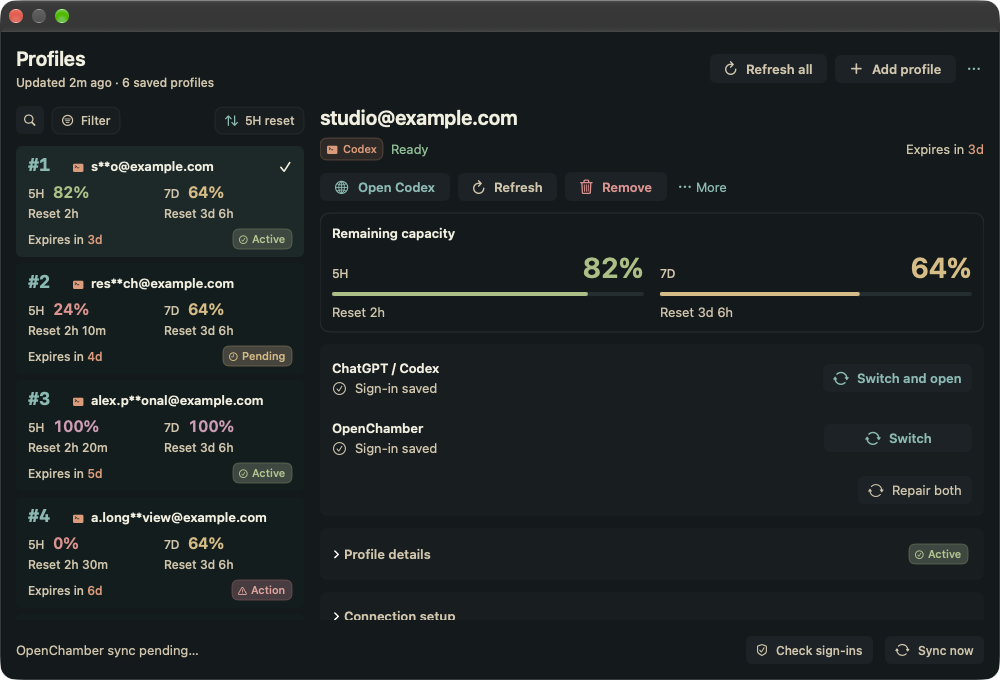
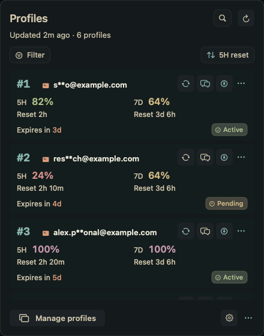
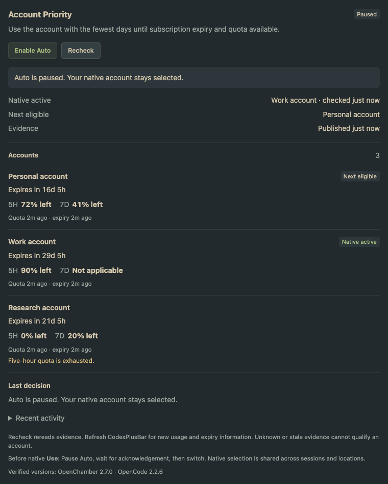

# CodexPlusBar

**Switch Codex accounts without signing in every time.**

CodexPlusBar is a **Mac account switcher for ChatGPT / Codex and OpenChamber**. Save your sign-ins, compare remaining quota, and switch to the account you need. Each browser account gets its own Chrome profile.

Hit a limit or need your work account? Switch to a saved sign-in instead of repeating the login flow.

**[Download for Mac](https://github.com/withLinda/CodexPlusBar/releases/latest/download/CodexPlusBar.dmg)** · [Quick start](#get-started) · [Release notes & checksums](https://github.com/withLinda/CodexPlusBar/releases/latest)

macOS 14+ · Apple silicon & Intel · Signed and notarized · [Google Chrome](https://www.google.com/chrome/) required for browser sign-in

*Choose an account, check its quota, and switch. Screenshots use sample accounts in 1.6.1; Account Priority uses extension 0.1.0.*

## Switch between your saved accounts

- **ChatGPT / Codex desktop:** choose **Switch and open** to verify the saved sign-in, change accounts, and reopen the app.
- **OpenChamber:** choose **Switch** to select the saved OpenAI account in your running local OpenChamber app.
- **Codex in Chrome:** choose **Open Codex** to open that account's dedicated browser profile.

### Set up app switching

1. [Add a profile](#get-started), then sign in to that account in ChatGPT / Codex or OpenChamber.
2. Choose **Save current sign-in** in that app's CodexPlusBar row. Repeat for each account and app.
3. Select a saved account, choose **Switch and open** or **Switch**, and wait for confirmation.

Finish active work before desktop switching: it closes and reopens the app. Browser sessions and app sign-ins are separate.

## Choose the right account—and keep it ready

### See your capacity at a glance

- **Compare your Codex accounts:** remaining **5H / 7D** usage, reset countdowns, refresh status, and subscription expiry when available.
- **Stay up to date:** refresh on launch, every five minutes, or manually.
- **Find an account quickly:** search by email or phone; filter by status tag or quota; sort by reset time, expiry, or your saved order.
- **Pin an account:** show its usage in the menu bar. Browse with **↑ / ↓**; zoom with **⌘+ / ⌘− / ⌘0**.

*Check what's available without leaving your work.*

### Keep accounts ready to use

- **Check and repair:** **Check sign-ins** verifies OpenChamber logins. **Repair both** sets up or renews both app sign-ins through Chrome; install ChatGPT / Codex and keep OpenChamber running.
- **Sync OpenChamber logins:** align its OpenAI login list with your Codex profiles. Sync is on by default and can remove surplus logins; turn it off in **Settings** for manual control.
- **Organize the details:** labels, links, notes, phone numbers, status tags, optional passwords, and 2FA secrets with copyable TOTP codes. Private fields stay covered until revealed.
- **Handle larger collections:** bulk-import email/password/2FA rows through **More → Import from Text…**, group by phone number, and track Gmail dot variations in **Email Tools**.
- **Make it yours:** light, dark, or system appearance; three contrast levels; adjustable dark canvas depth.
- **Sync between Macs:** opt in to [iCloud Sync](#icloud-sync) for profile details and saved login sessions. Review and import incoming sessions before using them.

## Get started

### Install from the DMG

1. [Download CodexPlusBar.dmg](https://github.com/withLinda/CodexPlusBar/releases/latest/download/CodexPlusBar.dmg). The same download supports Apple silicon and Intel Macs running macOS 14 or later.
2. Open the downloaded DMG and drag **CodexPlusBar.app** onto the **Applications** shortcut.
3. Eject the disk image, then open **CodexPlusBar** from Applications. Confirm macOS's first-open prompt if shown. The app appears in the **menu bar**, not the Dock.

The **1.7.2 DMG includes iCloud Sync** and fixes the checkbox turning itself off when sync starts. It also includes the profile-refresh fix from 1.7.1. Sync stays off until you enable it on each Mac. The app and DMG are Developer ID-signed, notarized by Apple, and stapled for offline ticket verification. [Version 1.7.2 release notes and SHA256SUMS](https://github.com/withLinda/CodexPlusBar/releases/tag/v1.7.2) include the download checksum.

### Add your first account

1. **Open the manager.** Click CodexPlusBar in the menu bar and choose **Manage profiles**.
2. **Add an account.** Choose **Add profile** and set its label in **Profile details**. Profiles now use Codex automatically.
3. **Sign in.** Choose **Open Codex** and sign in in the dedicated Chrome window. No API key is needed for usage tracking.
4. **Check your capacity.** Return and choose **Check now** if needed. Add your other accounts and pin a favorite.

Ready to change accounts in your apps? [Save their sign-ins and start switching](#set-up-app-switching).

**Reading the numbers:** percentages mean **remaining**, not used. `5H` and `7D` are quota windows. `—` means unavailable. Subscription expiry is separate from a quota reset. Changes to ChatGPT's website can temporarily affect refreshes.

**Updating?** Quit CodexPlusBar, open the latest DMG, drag the new app into Applications, and choose **Replace**. Eject the DMG, reopen the app, and refresh. Your saved Codex profiles and sign-ins stay in place; updating does not enable iCloud Sync. Existing backups can still be restored. If upgrading from before 1.6.2, earlier Claude records remain stored but inactive and hidden.

## Switch automatically in OpenChamber

The optional **Account Priority** extension automatically switches to the soonest-expiring eligible OpenAI subscription with usable quota. An account with **17 days left** takes priority over one with **30 days**—use your capacity before it expires.

*See which account is next—and why another account cannot be used.*

1. Use **CodexPlusBar 1.6.1 or later** and refresh your accounts.
2. [Download Account Priority](https://github.com/withLinda/CodexPlusBar/releases/download/v1.6.1/expiry-selector-0.1.0.zip), extract it, and install the **expiry-selector** folder in **OpenChamber → Settings → Extensions**. Approve its plugin and local-service capabilities.
3. Open **Account Priority**, check the accounts and expiry countdowns, disable OpenChamber's competing native limit-switch/fallback settings, then choose **Enable Auto**.

Keep CodexPlusBar running. Unknown, stale, or exhausted accounts cannot qualify; if none qualify, the current account stays selected. Selection is shared across OpenChamber sessions. Pause Auto before native **Use**. CodexPlusBar checks, switches, and repairs leave Auto paused until you resume it.

Verified with **OpenChamber 2.7.0 / OpenCode 2.2.6**. [Compatibility and recovery guide](Extensions/expiry-selector/README.md#supported-boundary).

## Take your setup to another Mac

Choose **Settings → Backup & Transfer → Export Backup…**, set a password, and transfer the `.codexplusbarbackup` file. On the new Mac, install CodexPlusBar and choose **Restore Backup…**.

Password-encrypted backups include profile details, saved sign-ins, browser data, Email Tools, and preferences. Keep the password. Some browser sessions may need a fresh sign-in.

### iCloud Sync

Included in the [1.7.2 DMG](https://github.com/withLinda/CodexPlusBar/releases/download/v1.7.2/CodexPlusBar.dmg). Install it on both Macs; no separate cloud build is needed. Local replica tests and signed Apple service probes passed; [live two-Mac acceptance, cross-device Keychain delivery, and automatic push delivery remain pending](docs/releases/2026-11-09-cloudkit-sync-validation.md#two-mac-acceptance--pending).

1. Sign in to the same iCloud account on both Macs and enable **Passwords & Keychain** in System Settings.
2. On each Mac, open **Settings → iCloud Sync → Sync accounts with iCloud**. Profile details, passwords and 2FA secrets merge with the local accounts.
3. **Include saved login sessions** starts on. Incoming browser, Codex and OpenChamber logins appear under **Saved sessions from iCloud**. Choose **Reload**, then **Import saved session** for the source Mac you want.

Import keeps a working local login when possible. Native imports save a login; **Switch** activates it. Expired or rotated credentials may need **Repair both** or a fresh sign-in. The selected native account and each Mac's browser stores stay local.

Use **Sync Now** to retry pending changes. Missing encryption keys show **Waiting for iCloud Keychain**. Turning sync or saved sessions off stops new work and keeps existing copies. Restoring a backup pauses sync until you explicitly enable it again to merge.

### Data storage

CodexPlusBar reads usage directly from OpenAI through your signed-in sessions. With iCloud Sync off, accounts stay local. When enabled, AES-GCM-encrypted payloads go to your private CloudKit database; app-owned encryption keys travel through iCloud Keychain. There is no CodexPlusBar-operated profile server.

**Local passwords, 2FA secrets, and saved sign-in files are not encrypted by CodexPlusBar.** Covered fields are not a password vault. Keep your Mac account and backups private. Removing a profile also removes its local browser data.

**[Download CodexPlusBar](https://github.com/withLinda/CodexPlusBar/releases/latest/download/CodexPlusBar.dmg)** · [Report a problem or request a feature](https://github.com/withLinda/CodexPlusBar/issues)
